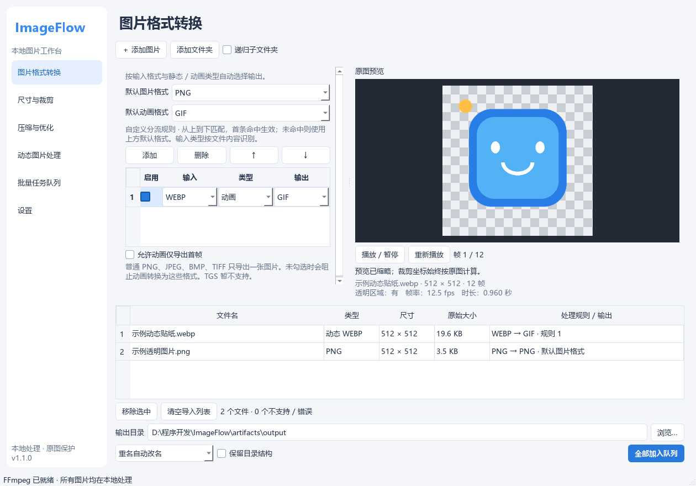

# ImageFlow

基于 Python / PySide6 / FFmpeg 的 Windows 本地图片工作台。支持静态图片和动画、鼠标裁剪、批量队列，以及按输入格式和动画类型自定义分流。所有图片只在本机处理；没有上传、遥测或云端转换接口。

1.1.0 新增：FFmpeg 一键配置、跟随系统主题、选项自动保存、自定义分流、首帧快速显示及预览缓存。全局输出格式和导入格式筛选已移除。

**[下载 Windows 便携版](https://github.com/icecream-suki/ImageFlow/releases/latest)** · [反馈问题](https://github.com/icecream-suki/ImageFlow/issues) · [测试报告](docs/TEST_REPORT.md)



[查看深色界面](docs/screenshots/dark.png)

## Windows 便携版

1. 完整解压 `ImageFlow-portable-win64.zip`，保留 `ImageFlow.exe` 旁的 `_internal` 文件夹。
2. 双击 `ImageFlow.exe`。不需要安装 Python、pip 或修改 PATH。
3. 在「设置」中点击「一键配置 FFmpeg」；也可手动选择自己的 `ffmpeg.exe`，程序自动查找同目录的 `ffprobe.exe`。
4. 点击「测试连接与格式能力」，确认所需格式可用。
5. 拖入图片或文件夹，调整输出参数与目录，点击「全部加入队列」，再到队列中点击「开始处理」。

FFmpeg 不随程序分发。可从 [FFmpeg 官方下载页](https://ffmpeg.org/download.html) 选择 Windows 构建。推荐具有 libwebp、libvpx、GIF palettegen/paletteuse 和 APNG 支持的构建；软件会检测实际能力，不要求所有构建支持同样的格式。

一键配置先检测已选路径、PATH、软件附近和常用工具目录；未找到可用工具时，从 [gyan.dev](https://www.gyan.dev/ffmpeg/builds/) 下载 Windows x64 essentials ZIP 与 SHA-256，校验后保存到 `portable_config/tools`（或实际回退配置目录）。支持下载中断续传、取消及失败清理，不修改系统 PATH。此功能仅在点击时联网；网络不可用时仍可直接选择本地工具。下载源更新或网络阻断可能导致失败，界面会显示原因。下载的 FFmpeg 保留自身许可证，不会进入 ImageFlow 发布 ZIP。

## 从源码运行

需要 Windows 10/11 x64、Python 3.12 或兼容版本，以及自己指定的 FFmpeg / FFprobe。

```powershell
cd .\ImageFlow
powershell -ExecutionPolicy Bypass -File .\scripts\setup.ps1
.\run.cmd
```

如果 Python 不在 PATH，可传入 `-Python 'C:\路径\python.exe'`。手动方式：

```powershell
python -m venv .venv
.\.venv\Scripts\python.exe -m pip install -r requirements-dev.txt
.\.venv\Scripts\python.exe run.py
```

生产依赖仅 `PySide6-Essentials` 和 `Pillow`。Essentials 提供 `PySide6.QtCore/QtGui/QtWidgets`，避免引入不使用的 WebEngine、视频、多媒体组件。精确版本在 requirements 文件中；Python 包兼容范围在 pyproject.toml 中。

## 使用说明

- **格式转换**：读取 PNG、JPEG、WebP、BMP、TIFF、GIF、APNG；静态输出 PNG/JPEG/WebP/BMP/TIFF。内容识别决定动画状态，不依赖扩展名猜测。
- **默认格式与分流**：在「图片格式转换」页选择默认图片格式、默认动画格式。规则可设置「输入格式 + 静态/动画/任意 → 输出格式」，支持启停、增删和上下排序；从上到下第一条匹配生效，未命中采用默认格式。导入列表显示实际输出与命中规则。例如：静态 WebP → PNG，动画 WebP → GIF，WebM → APNG。动画转普通静态格式仍须勾选允许只导出首帧。
- **尺寸与裁剪**：保留原始尺寸、等比放入边界、指定宽高、百分比四种互斥模式。可选择只缩小、尺寸预设、插值算法。启用裁剪后，在预览中拖选或输入原图 X/Y/宽/高；支持比例约束、90°或任意角度旋转与翻转。应用顺序：裁剪 → 缩放 → 旋转 → 翻转。
- **压缩**：JPEG 质量映射到 FFmpeg qscale；WebP 支持有损质量和无损编码；PNG 使用无损编码。JPEG/BMP 透明区域按选定背景色填充，默认白色。无损编码不代表能恢复先前有损编码丢失的细节。
- **动画**：GIF/APNG/动态 WebP 互转；保留逐帧时长或选择输出帧率。循环数指总播放次数，0 表示无限。质量预设会显示实际帧率、色数、抖动和透明度阈值；修改参数会标记为自定义。
- **贴纸**：默认图片 PNG、动画 GIF 即可批量处理贴纸，不再提供 Telegram 专用开关；用分流规则覆盖个别格式即可。尺寸页提供 512/320/256 等预设。导入 `.webm` 仅接受不带音频、宽高 ≤512、时长约 ≤3 秒的 VP8/VP9 贴纸，禁止扩展为普通视频转换。
- **批量**：导入多个文件、文件夹及递归扫描。所有导入文件共用加入队列时的参数与规则快照；队列运行期间可继续调整下一批参数。保留结构以每个导入文件夹为根，单独导入的文件不保留额外父目录。
- **队列**：默认并发 2、可选 1–4。开始、停止全部、取消等待、失败重试、日志、原图/输出预览和打开输出文件夹。失败重试保留原参数；要改变参数请重新加入。
- **预览**：静态与动画预览、播放/暂停/重播、当前帧。WebM 直接解码 RGBA 到内存，先显示首帧，再完成动画加载；独立后台线程和最近文件缓存减少重复等待。透明棋盘格不写入输出。任务完成后可分别预览原图与处理结果。
- **主题与自动保存**：主题可选跟随系统、浅色或深色；跟随系统会响应系统外观变化。处理参数、规则、目录与设置更改后约 0.4 秒自动保存，正常关闭会立即保存尚未写入的更改；并发数更改在当前批次结束后生效。

## 文件安全和配置

- 输出先写到目标磁盘上的 `.imageflow-*` 私有临时目录，成功后发布最终文件。
- 默认重名自动改名；可选择跳过或明确选择覆盖已有输出。所有已导入输入路径始终受到保护，包括同名输出和硬链接别名。
- 非覆盖模式使用原子硬链接发布，Windows 不支持硬链接的磁盘回退到不会覆盖现有目标的 rename。失败或取消清理本任务临时目录。
- 所有 FFmpeg 调用均使用 subprocess 参数列表、`shell=False`；中文、空格、Unicode、`&`、`%` 等文件名已纳入测试。
- Windows 取消会终止 FFmpeg 进程树；关闭窗口时先停止工作并清理，再退出。
- 配置默认在 EXE 旁的 `portable_config/settings.json`（源码模式为项目目录），日志在 `portable_config/logs`。不可写时回退到 `%LOCALAPPDATA%\ImageFlow`，设置页显示实际位置。不需要管理员权限。
- 损坏配置不会删除，程序恢复默认值并显示说明。选定路径失效时引导重新配置。
- 默认删除输出元数据；取消此项为尽力保留，不能保证完整保存 ICC、EXIF、XMP。

## 动画实现

Pillow 将 GIF/WebP/APNG 按 disposal/blend 合成为 RGBA 帧，写入私有 PNG 序列；concat manifest 采用毫秒时基和逐帧时长。由用户指定的 FFmpeg 执行几何变换、调色板优化和最终编码。APNG 的独立默认海报帧不会参与动画。

GIF 采用两遍处理：先用 palettegen 分析全局调色板，再用 paletteuse 流式编码，避免单遍 split 在等待全局调色板时缓存整个动画。支持透明色保留、抖动与阈值；GIF 只有最多 256 色和二值透明度，不承诺完整保存半透明边缘或原始颜色。

VP9 Alpha 的 WebM 输入在输入选项处强制使用 `libvpx-vp9`（VP8 为 `libvpx`）。缺少相应解码器时阻止声称保留透明度的转换。动画帧率调整使用 fps 滤镜按时间采样，不改变播放速度。GIF 的时间精度为百分之一秒，因此部分时长会量化。

FFmpeg/libwebp_anim 对末帧延时可能使用平均值估算。编码后按 WebP RIFF ANMF 规范修正末帧 duration，使总时长与输入一致；该修正不重编码像素。

GIF 体积上限采用最多 7 次有限尝试，逐步降低分辨率、帧率和色数。若仍超限，任务失败且不发布超限文件，技术日志记录实际参数。

参考：[FFmpeg 滤镜文档](https://ffmpeg.org/ffmpeg-filters.html)、[Pillow 图片格式文档](https://pillow.readthedocs.io/en/stable/handbook/image-file-formats.html)、[WebP 容器规范](https://developers.google.com/speed/webp/docs/riff_container)。

## 测试

```powershell
.\scripts\test.ps1 -FFmpeg 'D:\Tools\ffmpeg\bin\ffmpeg.exe' -FFprobe 'D:\Tools\ffmpeg\bin\ffprobe.exe'
```

或设置 `IMAGEFLOW_FFMPEG` / `IMAGEFLOW_FFPROBE` 后运行 `python -m pytest -q -ra`。没有 FFmpeg 时，集成测试明确跳过，不记作成功转换。GUI 测试使用 Qt offscreen，真实走导入、队列、转换和鼠标裁剪流程。测试生成自己的图片，不修改用户素材。测试报告见 `docs/TEST_REPORT.md`。

## 打包

```powershell
.\scripts\build.ps1
# 结果：dist\ImageFlow\ImageFlow.exe
```

PyInstaller 生成独立目录、无控制台程序，不包含 FFmpeg。必须分发整个 ImageFlow 文件夹。脚本不会删除已有输出目录，重复构建请传入新的 `-Destination 'dist-next'`，防止破坏便携配置。可使用 `Compress-Archive -Path .\dist\ImageFlow -DestinationPath .\dist\ImageFlow-portable-win64.zip` 压缩分发。

打包脚本临时隔离依赖搜索 PATH，过滤不需要的 Qt 模块，并检查 Qt DLL 能否真实加载，避免其他已安装工具提供的同名 ICU DLL 污染便携包。该操作只改变构建子进程的环境，不修改 Windows 系统环境变量。

可运行 `python scripts/verify_package.py dist-v1.1/ImageFlow/ImageFlow.exe` 验证 EXE：在只有 Windows System32 的 PATH 下分别启动离屏 Qt 与原生 Windows Qt，切换页面、转换透明图片并保存结果。设置 `IMAGEFLOW_FFMPEG` 和 `IMAGEFLOW_FFPROBE` 时包含真实转换，否则只验证 GUI。`python scripts/package_release.py --dist dist-v1.1` 生成源码和便携版压缩包。新版完整解压到新目录后，可将旧版 `portable_config` 复制过来继续使用原设置；不要混用两版 `_internal`。

## 目录结构

```text
ImageFlow/
  imageflow/
    app.py                  GUI 入口、错误捕获
    models.py               文件信息、参数、任务模型
    config.py               便携配置、回退、原子保存
    capabilities.py         FFmpeg/FFprobe 路径与能力检测
    tool_setup.py           本地查找、下载续传、校验与工具配置
    routing.py              按内容与动画类型顺序匹配输出规则
    probe.py                格式识别、文件夹扫描
    commands.py             纯 FFmpeg 参数构建与几何计算
    animation.py            动画合成与时间戳辅助
    process.py              子进程、进度、取消、日志
    engine.py               转换、安全输出、体积优化
    queue.py                受控并行任务队列
    gui/                    主窗口、设置、参数表单、预览、后台工作器
  tests/                    单元 / 集成 / GUI 测试
  scripts/                  Windows 安装依赖、测试、打包脚本
  docs/                     验证报告
  artifacts/                测试报告和界面截图
  ImageFlow.spec            PyInstaller 配置
  run.py / run.cmd          开发运行入口
  requirements*.txt         固定依赖
```

## 已知限制和后续扩展

- TGS 只识别并明确提示，不安装额外 Lottie 引擎。未来可在导入层增加独立可选渲染器，把合成帧交给相同编码流水线。
- 不支持多页 TIFF，避免静默丢失页面。可扩展专门的页面导出模块。
- 当前处理流水线以 8 位 RGBA 为主，不是 16 位/HDR、印刷 CMYK 或 ICC 色彩管理工具。EXIF 方向不自动应用；预览和裁剪使用文件原始像素方向，可手动旋转。
- 图片动画预览最多 300 帧或约 64MB 解码像素；超过时提示只预览前段。WebM 预览最高 400 像素、20fps；这仅影响显示，转换遵循输出参数。最近预览缓存最多 8 项 / 128MB，按文件修改时间及大小失效。导入限制单帧 8000 万像素和 10000 帧；完整动画转换需要目标磁盘有足够临时空间。
- 未声明有效延时的帧按 100ms 处理并明确提示。所有帧完全相同的动态 WebP 可能被编码器合并为静态图，日志会说明。
- 保留元数据为尽力模式，尤其经过动画帧合成后不保证元数据完整。JPEG 质量值是 FFmpeg qscale 映射，不等同于 Photoshop 质量标尺。
- GIF 或动画参数不保证满足所有 QQ 客户端限制；接收平台的导入、展示、体积限制需要在实际客户端确认。
- 未做代码签名、安装器或自动更新。便携版可移到用户有写权限的位置运行。后续可扩展色彩管理、对比滑块、任务持久化与崩溃后恢复。
